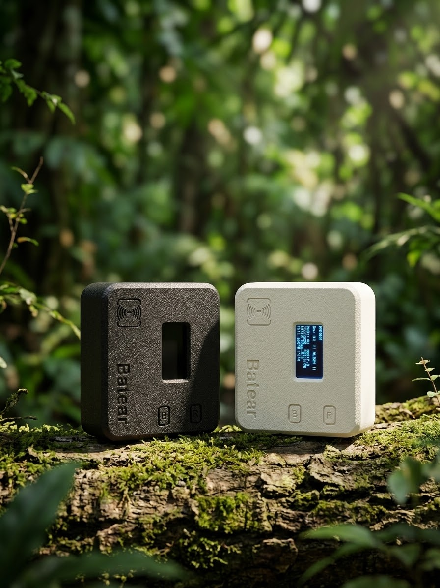

---
hide:
  - navigation
---

# Batear

**Ultra-low-cost, edge-only acoustic drone detection on ESP32-S3 with encrypted LoRa or wired Ethernet alerting.**

 

*"Built for defense, hoping it becomes unnecessary. We believe in a world where no one needs to fear the sky."*

 

*:arrow_forward: Click to watch the bench test demo*

---

## What is Batear?

Drones are an increasing threat to homes, farms, and communities — and effective detection has traditionally required expensive radar or camera systems. **Batear changes that.**

For ultra-low-cost hardware, Batear turns a tiny ESP32-S3 microcontroller and a MEMS microphone into an always-on acoustic drone detector. It runs entirely at the edge — **no cloud subscription, no internet connection, no ongoing cost.** Deploy one at a window, a fence line, or a rooftop and it will alert you the moment drone rotor harmonics are detected nearby.

One **LoRa node** firmware runs as a **Detector** (mic + LoRa TX), a **Relay** (re-transmits other nodes' packets), or a **Gateway** (LoRa RX + OLED + LED + MQTT) — chosen per device at flash time — and the nodes form a small mesh. Any number of gateways forward alerts to **Home Assistant** via MQTT with automatic device discovery. The **Wired Detector** is a separate build that connects directly over Ethernet, bypassing LoRa entirely.

## Key Features

- :microphone: **Acoustic detection** — FFT harmonic signature analysis of drone rotor noise
- :lock: **AES-128-GCM encryption** — secure LoRa communication between devices
- :satellite: **LoRa alerting** — long-range, low-power wireless alerts
- :spider_web: **Mesh relay + multiple gateways** — relays extend range; several gateways give failover without duplicate HA devices
- :house: **Home Assistant integration** — MQTT with auto-discovery, LWT availability, per-detector topics
- :zap: **Edge-only** — no cloud, no internet, no subscription
- :moneybag: **Ultra-low-cost** — under $20 per node with off-the-shelf parts
- :electric_plug: **Wired option** — Ethernet/PoE variant for fixed installations (no LoRa needed)
- :package: **One LoRa firmware** — Detector, Relay or Gateway is a per-device setting; Wired Detector is its own build

## Quick Start

-   :material-flash:{ .lg .middle } **Web Flasher**

    ---

    Flash firmware from your browser — no toolchain required

    [:octicons-arrow-right-24: Open Web Flasher](https://docs.batear.io/flasher/){ target="_blank" }

-   :material-tools:{ .lg .middle } **Hardware Setup**

    ---

    Get the parts list and wiring diagram

    [:octicons-arrow-right-24: Hardware](hardware.md)

-   :material-rocket-launch:{ .lg .middle } **Build & Flash**

    ---

    Build the firmware and flash your device

    [:octicons-arrow-right-24: Build & Flash](build-flash.md)

-   :material-cog:{ .lg .middle } **Configuration**

    ---

    Set up encryption keys, frequencies, and device IDs

    [:octicons-arrow-right-24: Configuration](configuration.md)

-   :material-brain:{ .lg .middle } **How It Works**

    ---

    Understand the FFT harmonic detection algorithm

    [:octicons-arrow-right-24: How It Works](how-it-works.md)

## 3D-Printable Case

[{ width="420" }](https://makerworld.com/en/models/3581398-batear-case){ target="_blank" }

Give your node a proper home. This community-designed enclosure for the **Heltec WiFi LoRa 32 V3** by [@nelson8588x2](https://github.com/nelson8588x2) has a window for the OLED and access to the buttons — **download the model and print your own:**

[:material-printer-3d: Download on MakerWorld](https://makerworld.com/en/models/3581398-batear-case){ .md-button .md-button--primary target="_blank" }
[:material-github: STEP files on GitHub](https://github.com/nelson8588x2/batear-case){ .md-button target="_blank" }
